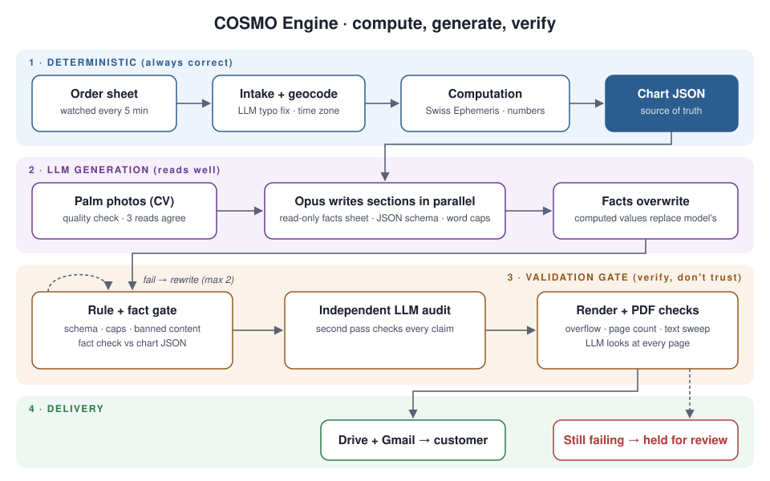

# COSMOGRAM · COSMO Engine

**An LLM pipeline that writes long reports and checks them before they ship.** The engine computes every
fact deterministically, a language model writes only the prose, and a validation gate checks that prose
against the computed facts before a 10 to 37 page PDF goes to a paying customer. No person reviews the
reports before they are sent.

> Built for COSMOGRAM, a live product that sells personalised astrology and "energetic blueprint" reports.
> The subject is astrology; the engineering problem is general: **how do you let a probabilistic model produce
> customer-facing documents without it inventing facts, breaking the layout or failing silently?**

---

## The problem

Each report combines many systems (a natal chart, Human Design, numerology, calendars, Ayurveda and, optionally,
a palm reading) into one personalised document. The first version asked Claude to do everything: compute
planetary positions, do the arithmetic and write the text, all inside a Make.com → Claude → PDFMonkey workflow.
That version failed in four ways:

| Failure | What happened |
|---|---|
| Hallucinated facts | Planetary degrees, rising signs and numerology totals were sometimes wrong |
| Broken output | Stray text, unclosed brackets or a reply cut off by a timeout crashed the JSON parser |
| Layout overflow | Variable-length text overflowed fixed PDF pages and hid content |
| Silent failures | API timeouts killed the workflow, and the customer never received a report |

## The architecture



```
order sheet ─▶ watcher (every 5 min, deduplicated by fingerprint) ─▶ job queue
   ─▶ intake cleaning ─▶ geocoding + historical time zone (Opus fixes typos in the birthplace first)
   ─▶ DETERMINISTIC LAYER: Swiss Ephemeris chart, Human Design, Gene Keys, numerology, transits 2018-2040
   ─▶ computed_chart.json  (single source of truth)
   ─▶ LLM LAYER: Opus writes report sections in parallel, under a strict JSON schema with word caps
   ─▶ engine facts overwrite any fact field the model wrote
   ─▶ VALIDATION GATE: schema · word caps · banned-content rules · fact check against the chart
        └─ failing sections rewritten (at most 2 rounds) ─▶ independent Opus fact audit
   ─▶ render (Chromium) ─▶ PDF checks: overflow, page count, banned words in the extracted text
   ─▶ Opus page-by-page visual check ─▶ Drive + Gmail delivery ─▶ status written back to the sheet
```

### Key design decisions

1. **Compute, then generate.** The model never computes a fact. Positions come from Swiss Ephemeris, and
   numerology and calendar systems from code. The model receives the facts as a read-only "facts sheet", and
   after it writes, the engine overwrites every fact field again, so a hallucinated value can never reach the PDF.
2. **Verify, don't trust.** Each section goes through a gate that combines rules (schema, caps, banned
   content, pronoun and scope checks) with fact-checking against the computed chart. A section that fails is
   regenerated with the error in the prompt, at most twice; a report that still fails is held and flagged for
   a person to review.
3. **Agreement before use for vision input.** The palm-reading add-on checks each client photo's quality, runs
   three independent model reads of the hand, and keeps only the features the reads agree on, which reduces
   one-off visual hallucinations.
4. **Layout that cannot hide content.** Word caps in the schema are matched to the space on each page and
   proven with stress payloads (every field at its cap, 25% over its cap, no birth time, very long names). A
   fit-to-page guard shrinks text slightly instead of cutting it off.
5. **Cost-aware orchestration.** Parallel section writing; the Message Batches API for scheduled monthly
   reports (half price); reuse of a returning customer's existing report; optional model routing (Opus sets the
   theme, Sonnet writes the routine copy); cost recorded for every stage.

## Results

- 5 report products running: Free (8 pp), Core (~14 pp), Full (35-37 pp, with an optional palm add-on), Annual
  Forecast and a 12-month forecast series that schedules itself
- Reports delivered automatically to paying customers; failures stop at "Needs review" instead of failing
  silently
- **700+ correctness tests** of template-side maths against independent implementations, with lunations
  checked against published eclipse dates, plus 13 offline end-to-end and gate test modules (including tests
  that plant errors and check the gate catches them)
- Measured cost per report: about $3.00 for a full 37-page report, about $0.60 for the free one

## Tech stack

Python · FastAPI · Anthropic Claude API (Opus / Sonnet, structured output, Message Batches) · Swiss Ephemeris
(`pyswisseph`) · Pillow · pypdf / pypdfium2 · Google Sheets, Drive and Gmail APIs · Docker on Render ·
HTML/CSS + Liquid templates · Node (LiquidJS, Puppeteer) · pytest

Earlier version: Make.com · PDFMonkey · Google Sheets

## Evolution

| Stage | Approach | Lesson |
|---|---|---|
| v1-v5 | Make.com + one large Claude prompt + PDFMonkey | One prompt that does everything is unreliable |
| v6 | Granular schema, word caps, retries, a Claude repair step, alerting | Reliability needs layered checks |
| Engine | Deterministic computation + LLM writing + validation gate | Separate what must be correct from what must read well |

## About the code

The source code is private because COSMOGRAM is a live commercial product. This repository documents the
architecture, the design decisions and the results. I'm happy to walk through the code in an interview or on a
call: reach me on [LinkedIn](https://www.linkedin.com/in/sadaan-baksh) or at 23f3002209@ds.study.iitm.ac.in.

*No customer data, credentials or order records are included here.*
